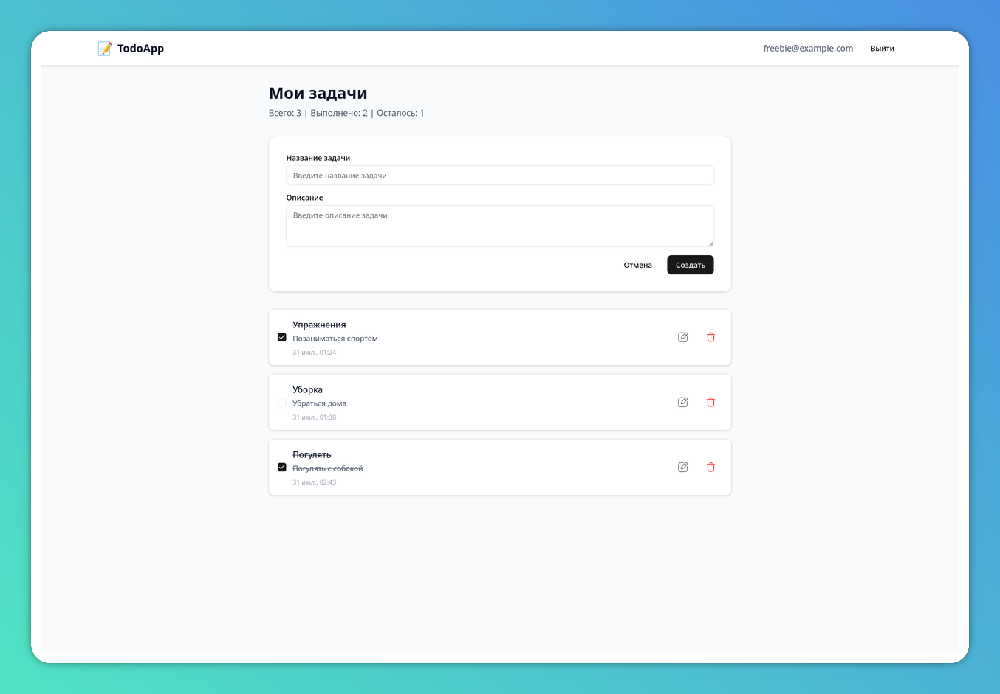
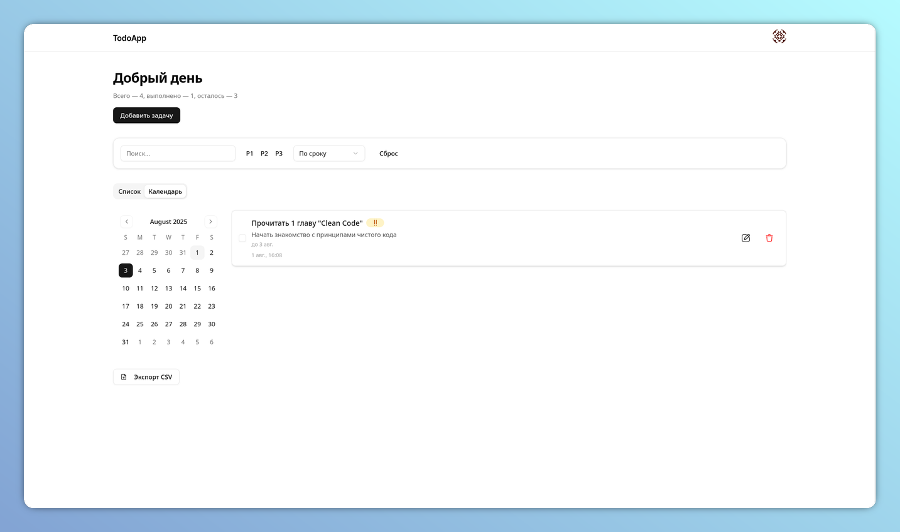

# Todo Fullstack App
[Русская версия](#русская-версия) | [English Version](#english-version)

## 🌐 Live Demo 
[](https://byntonna-todoapp.vercel.app)


## Русская версия
Современное fullstack приложение для управления задачами, построенное с использованием Nuxt v4, FastAPI
и PostgreSQL.

### Особенности
- Аутентификация и авторизация с JWT токенами
- Короткие access токены (1 час) и refresh токены на 6 месяцев с автоматическим продлением
- Адаптивный дизайн с shadcn/vue
- Категории и теги для задач
- Docker для легкого развертывания
- Безопасность с хешированием паролей
- Валидация данных на всех уровнях

### Архитектура
```
todo-fullstack/
├── frontend/          # Nuxt v4 приложение
│   ├── components/    # Vue компоненты
│   ├── pages/         # Страницы приложения
│   ├── stores/        # Pinia stores
│   ├── middleware/    # Nuxt middleware
│   └── layouts/       # Layouts
├── backend/           # FastAPI приложение
│   └── app/
│       ├── routers/   # API роуты
│       ├── models.py  # SQLAlchemy модели
│       ├── schemas.py # Pydantic схемы
│       ├── crud.py    # CRUD операции
│       └── auth.py    # Аутентификация
├── database/          # SQL миграции
└── docker-compose.yml # Оркестрация сервисов
```

### Технологический стек

#### Frontend
- [**Nuxt v4**](https://nuxt.com/) - Vue.js фреймворк с SSR
- [**shadcn-vue**](https://www.shadcn-vue.com/) - Современная UI библиотека
- [**Pinia**](https://pinia.vuejs.org/) - Управление состоянием
- **TypeScript** - Типизация

#### Backend
- **FastAPI** - Современный Python веб-фреймворк
- **SQLAlchemy** - ORM для работы с БД
- **Pydantic** - Валидация данных
- **JWT** - Аутентификация
- **bcrypt** - Хеширование паролей

#### База данных
- **PostgreSQL** - Реляционная база данных

#### DevOps
- **Docker & Docker Compose** - Контейнеризация

***

### Быстрый старт

#### Предварительные требования

- Node.js >= 18.0.0
- Python >= 3.8
- Docker и Docker Compose

#### 1. Клонирование репозитория
```bash
git clone https://github.com/byntonna/Fullstack-todoApp-Nuxt-FastAPI.git
cd Fullstack-todoApp-Nuxt-FastAPI
```
#### 2. Запуск с Docker (НЕ РАБОТАЕТ)
```bash
docker-compose up -d

# Приложение будет доступно по адресам:
# Frontend: http://localhost:3000
```
TODO: Реализовать Backend в Docker контейнер

#### 3. Ручная установка

##### Backend
```bash
cd backend
python -m venv .venv
source .venv/bin/activate  # Linux / Mac
# или
.venv\Scripts\activate  # Windows

pip install -r requirements.txt

touch .env
# Отредактировать .env файл
# AUTH_SECRET_KEY=<jwt-ключ>

# Запуск БД
docker run -d \
  --name postgres-todo \
  -e POSTGRES_DB=todoapp \
  -e POSTGRES_USER=todouser \
  -e POSTGRES_PASSWORD=todopass \
  -p 5432:5432 \
  postgres:15

# Запуск сервера
gunicorn app.main:app --worker-class uvicorn.workers.UvicornWorker --bind 0.0.0.0:8000 --reload
```

##### Frontend
```bash
cd frontend

npm install  # Установка зависимостей

# Запуск dev-сервера
npm run dev
```

### TODO (Дальнейшие улучшения)

 - WebSocket для real-time обновлений
 - ~~Фильтры и сортировка задач~~
 - ~~Категории и теги~~
 - Прикрепление файлов
 - Совместная работа над задачами
 - Интеграция с календарем
 - ~~Экспорт данных~~
 - ~~Темная тема~~

***

## English Version
A modern fullstack task management application built with Nuxt v4, FastAPI and PostgreSQL.

### Features
- Authentication and authorization with JWT tokens
- Short-lived access tokens (1 hour) and refresh tokens for 6 months with automatic renewal
- Responsive design with shadcn/vue
- Categories and tags for tasks
- Docker for easy deployment
- Security with password hashing
- Data validation at every level

### Architecture
```
todo-fullstack/
├── frontend/          # Nuxt v4 application
│   ├── components/    # Vue components
│   ├── pages/         # Application pages
│   ├── stores/        # Pinia stores
│   ├── middleware/    # Nuxt middleware
│   └── layouts/       # Layouts
├── backend/           # FastAPI application
│   └── app/
│       ├── routers/   # API routes
│       ├── models.py  # SQLAlchemy models
│       ├── schemas.py # Pydantic schemas
│       ├── crud.py    # CRUD operations
│       └── auth.py    # Authentication
├── database/          # SQL migrations
└── docker-compose.yml # Service orchestration
```

### Tech Stack

#### Frontend
- [**Nuxt v4**](https://nuxt.com/) - Vue.js framework with SSR
- [**shadcn-vue**](https://www.shadcn-vue.com/) - Modern UI library
- [**Pinia**](https://pinia.vuejs.org/) - State management
- **TypeScript** - Type safety

#### Backend
- **FastAPI** - Modern Python web framework
- **SQLAlchemy** - ORM for working with the database
- **Pydantic** - Data validation
- **JWT** - Authentication
- **bcrypt** - Password hashing

#### Database
- **PostgreSQL** - Relational database

#### DevOps
- **Docker & Docker Compose** - Containerization

***

### Quick Start

#### Requirements
- Node.js >= 18.0.0
- Python >= 3.8
- Docker and Docker Compose

#### 1. Clone the repository
```bash
git clone https://github.com/byntonna/Fullstack-todoApp-Nuxt-FastAPI.git
cd Fullstack-todoApp-Nuxt-FastAPI
```

#### 2. Run with Docker (NOT WORKING YET)
```bash
docker-compose up -d

# Application will be available at:
# Frontend: http://localhost:3000
```
TODO: Implement Backend in Docker container

#### 3. Manual setup

##### Backend
```bash
cd backend
python -m venv .venv
source .venv/bin/activate  # Linux / Mac
# or
.venv\Scripts\activate  # Windows

pip install -r requirements.txt

touch .env
# Edit .env file
# AUTH_SECRET_KEY=<jwt-secret>

# Start database
docker run -d \
  --name postgres-todo \
  -e POSTGRES_DB=todoapp \
  -e POSTGRES_USER=todouser \
  -e POSTGRES_PASSWORD=todopass \
  -p 5432:5432 \
  postgres:15

# Start server
gunicorn app.main:app --worker-class uvicorn.workers.UvicornWorker --bind 0.0.0.0:8000 --reload
```

##### Frontend
```bash
cd frontend

npm install  # Install dependencies

# Start dev server
npm run dev
```

### TODO (Future Improvements)

- WebSocket for real-time updates
- ~~Task filtering and sorting~~
- File attachments
- Collaboration on tasks
- Calendar integration
- ~~Data export~~
- ~~Dark theme~~
